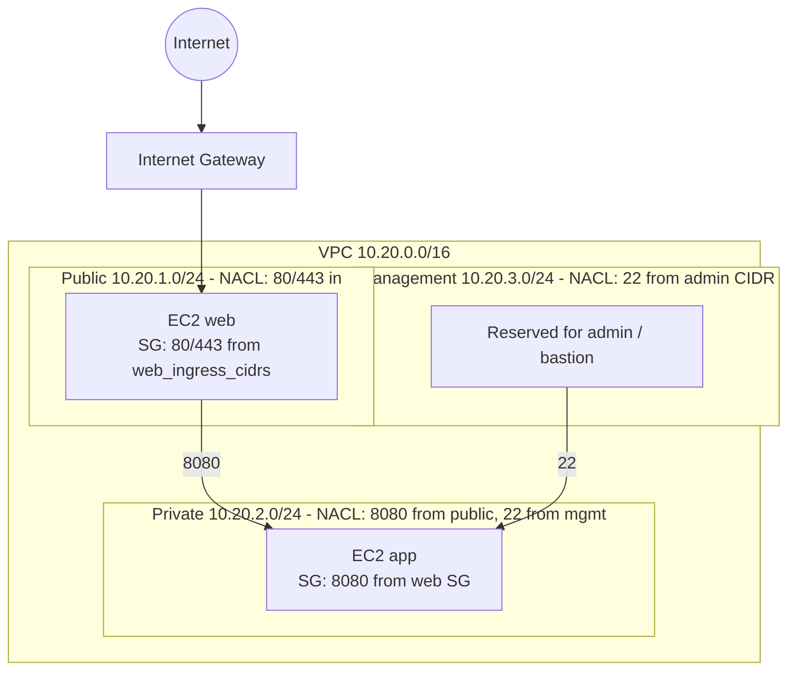

# IaC Network Lab

[](https://github.com/AJJudkins/iac-network-lab/actions/workflows/ci.yml)

Terraform for a small, segmented AWS network (VPC with public / private / management subnets, security groups, NACLs, two EC2 instances) plus an Ansible playbook that applies baseline hardening to a Linux host.

> **Validated, never applied.** This code was checked only with `terraform fmt`, `terraform validate`, `tflint` (core + AWS ruleset), `ansible-playbook --syntax-check` and `ansible-lint`, locally and in CI. **No `terraform plan` or `apply` has been run** (that needs AWS credentials) and the playbook has not been run against any host. Nothing here has been deployed to a real AWS account. All names, CIDRs and addresses are generic examples (`10.20.0.0/16`, `203.0.113.10/32` documentation range). No real company or network details are included.

## Problem
Network segmentation and host hardening are easy to get wrong when done by hand. Expressing them as code makes them reviewable and repeatable.

## Architecture


- Public subnet routes to the internet gateway; private and management subnets have **no** internet route (no NAT gateway, to avoid cost).
- NACLs are stateless (explicit ephemeral-port rules); security groups are stateful.
- EC2: Amazon Linux 2023, IMDSv2 required, encrypted root volumes, no public IP, no SSH key pair. **Off by default** (`create_instances = false`), so a first apply is network-only.
- **Default-deny:** `web_ingress_cidrs` defaults to `[]` (nobody can reach the web tier), the VPC's default security group is stripped of all rules, and `admin_cidr` rejects `0.0.0.0/0`. NACLs are a second, coarser layer; the security groups are the real gate.
- The management subnet is defined and protected, but contains no instance (reserved for a bastion you would add).

## Ansible hardening (`ansible/harden.yml`)
SSH (no root login, no passwords, max 3 tries, validated with `sshd -t`), kernel network sysctls, removal of legacy packages (telnet, rsh, ypbind), auditd enabled, and permissions on `/etc/passwd`, `/etc/shadow` and `sshd_config`. Note: the playbook is lint-clean but untested on a live host.

## Setup
Terraform >= 1.5, [tflint](https://github.com/terraform-linters/tflint), and `pip install ansible-core ansible-lint` plus `ansible-galaxy collection install ansible.posix`.

## Variables
Copy `terraform/example.tfvars` to `terraform/terraform.tfvars` (git-ignored) and edit.

| Variable | Default | Notes |
|---|---|---|
| `region` | `us-west-2` | |
| `name` | `netlab` | validated: lowercase letters, digits, hyphens |
| `vpc_cidr` | `10.20.0.0/16` | validated: must be a /16 |
| `admin_cidr` | `203.0.113.10/32` | validated; `0.0.0.0/0` rejected. Set to your own /32 |
| `web_ingress_cidrs` | `[]` | default-deny; list CIDRs to open 80/443 |
| `create_instances` | `false` | network-only (free) until true |
| `instance_type` | `t3.micro` | limited to t3.nano/micro/small |

## Usage: validate, then plan, and only then (maybe) apply
```bash
# 1. Static checks (no AWS credentials needed). This is all that has been run on this repo.
cd terraform
terraform fmt -check -recursive
terraform init -backend=false
terraform validate
tflint --init --config=../.tflint.hcl && tflint --config=../.tflint.hcl

cd ../ansible
ansible-playbook -i inventory.ini harden.yml --syntax-check
ansible-lint harden.yml
```
```bash
# 2. Plan (needs credentials for a SANDBOX account you control; NOT run for this repo)
cd terraform && terraform init
terraform plan -var-file=terraform.tfvars -out=tfplan
terraform show tfplan          # read every resource before continuing

# 3. Apply only the reviewed plan, in a sandbox account; tear down afterwards
terraform apply tfplan
terraform destroy -var-file=terraform.tfvars
```
```bash
# Ansible: dry-run first, against a disposable VM
ansible-playbook -i inventory.ini harden.yml --check --diff
```
Optional: `pip install pre-commit && pre-commit install` enables the hooks in `.pre-commit-config.yaml` (fmt, validate, tflint, YAML and private-key checks). The hook config has not been exercised.

## Cost notes (approximate; check current AWS pricing for your region)
- **Default (`create_instances = false`):** VPC, subnets, route tables, internet gateway, security groups and NACLs have no hourly charge, so this is about $0. No NAT gateway, load balancer, Elastic IP or public IPv4 address is created.
- **With instances:** two `t3.micro` at roughly $0.01/hour each (about $7-8/month each if left running 24/7) plus small encrypted EBS root volumes (about a dollar a month each). Run `terraform destroy` when finished.

## Safety
- Review the plan before applying; use a sandbox account, never a production one.
- State and `*.tfvars` are git-ignored; never commit them or credentials. No secrets are in this repo.
- Test the Ansible playbook on a disposable VM first: SSH changes can lock you out.
- See `SECURITY.md` for what is and is not verified.

## What it demonstrates
Network segmentation, layered controls (NACL + security group), least privilege, IaC practices (variables, outputs, validation), and Linux hardening automation.

## Security and testing status

- **Safety:** Terraform defaults are deny-by-default (no web ingress CIDRs, empty default security group, `admin_cidr` rejects 0.0.0.0/0), instances are off unless `create_instances = true`, state and `*.tfvars` are git-ignored, and no secrets are in the repo. Always review `terraform plan` and use a sandbox account.
- **Tested:** `terraform fmt -check`, `terraform init -backend=false`, `terraform validate`, `tflint` (core + AWS ruleset), `ansible-playbook --syntax-check` and `ansible-lint`, locally and in CI.
- **Not tested:** `terraform plan` and `terraform apply` (they need AWS credentials and were never run), the real cost of a deployment, the pre-commit hook configuration, and the Ansible playbook on any real host.
- See [SECURITY.md](SECURITY.md).

## License
MIT
