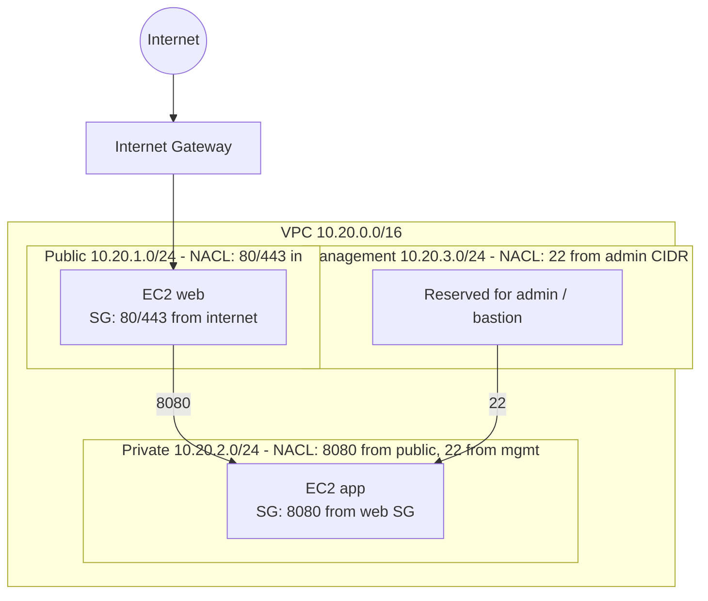

# IaC Network Lab

Terraform for a small, segmented AWS network (VPC with public / private / management subnets, security groups, NACLs, two EC2 instances) plus an Ansible playbook that applies baseline hardening to a Linux host.

> **Never applied.** This code was validated only with `terraform fmt`, `terraform validate`, `ansible-playbook --syntax-check` and `ansible-lint`. It has **not** been applied to any AWS account or run against any host. All names, CIDRs and addresses are generic examples (`10.20.0.0/16`, `203.0.113.10/32` documentation range). No real company or network details are included.

## Problem
Network segmentation and host hardening are easy to get wrong when done by hand. Expressing them as code makes them reviewable and repeatable.

## Architecture


- Public subnet routes to the internet gateway; private and management subnets have **no** internet route (no NAT gateway, to avoid cost).
- NACLs are stateless (explicit ephemeral-port rules); security groups are stateful.
- EC2: Amazon Linux 2023, IMDSv2 required, encrypted root volumes, no public IP, no SSH key pair.
- The management subnet is defined and protected, but contains no instance (reserved for a bastion you would add).

## Ansible hardening (`ansible/harden.yml`)
SSH (no root login, no passwords, max 3 tries, validated with `sshd -t`), kernel network sysctls, removal of legacy packages (telnet, rsh, ypbind), auditd enabled, and permissions on `/etc/passwd`, `/etc/shadow` and `sshd_config`. Note: the playbook is lint-clean but untested on a live host.

## Setup
Requires Terraform >= 1.5, and `pip install ansible ansible-lint` plus `ansible-galaxy collection install ansible.posix` (included with the full `ansible` package).

## Usage (validation only)
```bash
cd terraform
terraform fmt -check -recursive
terraform init -backend=false
terraform validate

cd ../ansible
ansible-playbook -i inventory.ini harden.yml --syntax-check
ansible-lint harden.yml
```
Results when this was written: `terraform validate` -> "The configuration is valid."; ansible-lint -> "Passed: 0 failure(s), 0 warning(s)".

## Cost and safety
- Do **not** apply to an account you care about without reviewing the plan. If you do apply it to a personal sandbox, expect roughly a few dollars per month for two `t3.micro` instances plus small EBS volumes (varies by region; check current AWS pricing). There are no NAT gateways or load balancers. Run `terraform destroy` when done.
- Set `admin_cidr` to your own `/32` before use; the default is a non-routable documentation address.
- Terraform state and `*.tfvars` are git-ignored; never commit them or credentials.
- Test the Ansible playbook on a disposable VM first: SSH changes can lock you out.

## What it demonstrates
Network segmentation, layered controls (NACL + security group), least privilege, IaC practices (variables, outputs, validation), and Linux hardening automation.

## License
MIT
